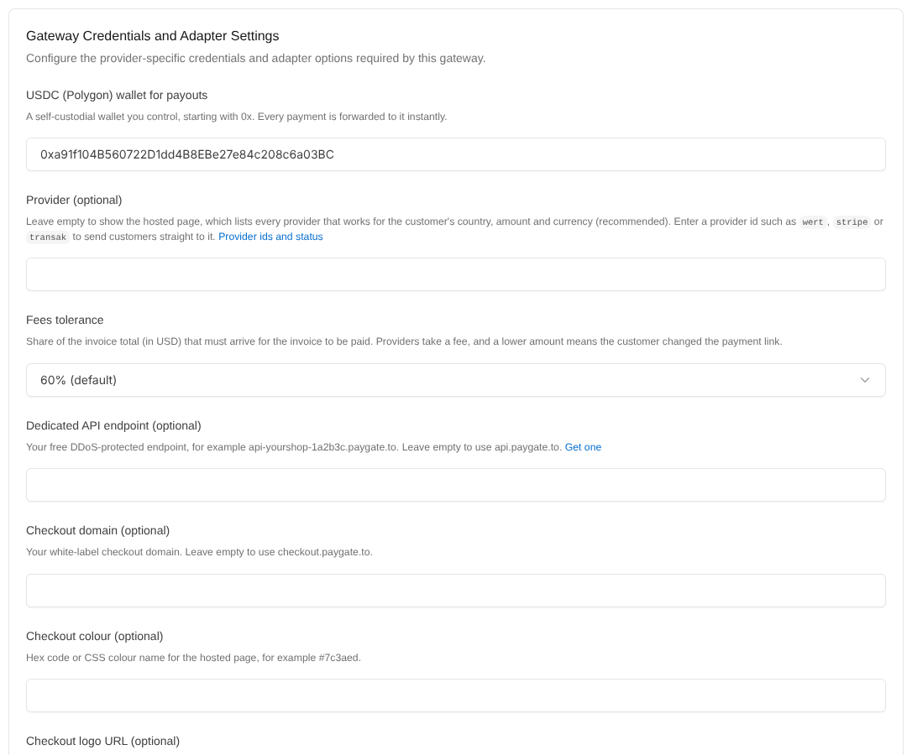
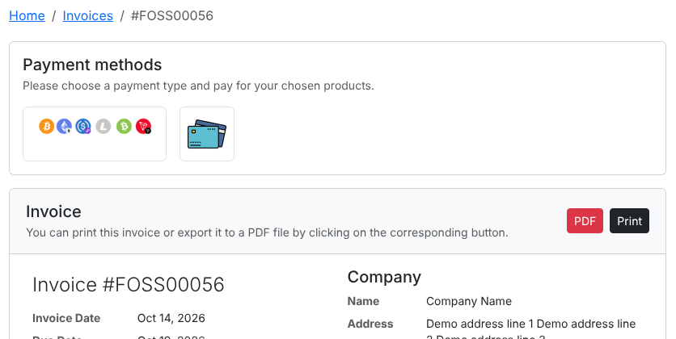
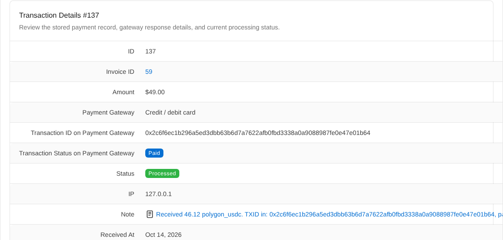

# Instant Payment Gateway FOSSBilling
Instant FOSSBilling payment gateway to accept credit or debit cards, Google Pay or Apple Pay. Every payment is paid out instantly to your USDC wallet.

> 🪙 **Want crypto too?** Our free [FOSSBilling crypto module](https://github.com/paygate-to/FOSSBilling-Crypto-Payment-Gateway) is the only crypto payment gateway with instant payouts for Solana, Monero, Zcash and Bitcoin.

## Features

- Accept **Visa, Mastercard, Apple Pay, Google Pay**, SEPA and local bank transfers on your FOSSBilling invoices.
- **Instant approval**: no sign up, no merchant account, no API keys and no KYC for you.
- **Instant payouts** to your own USDC (Polygon) wallet with every payment.
- **Zero chargebacks**: all payments are final.
- Multi-provider hosted payment page that picks the best provider for each customer's country, or one provider of your choice.
- **Secure confirmations**:
  - every payment confirmation is signed by PayGate.to and checked against the bundled public key;
  - every callback URL is signed with your installation's secret;
  - repeated confirmations are ignored;
  - the payout must go to your wallet, and the amount received is compared with the invoice total.
- Works with your own checkout domain and a free dedicated API endpoint ([custom domain guide](https://paygate.to/white-label-api-custom-domain-guide/)).
- Fees: **1% + provider fees**.

📘 **Step-by-step guide:** [https://paygate.to/instant-payment-gateway/fossbilling/](https://paygate.to/instant-payment-gateway/fossbilling/)



## Requirements

- **FOSSBilling 0.7.2 or newer.** Tested on 0.7.2 and 0.8.8.
- PHP with the OpenSSL extension, which FOSSBilling already requires.
- Access to your server files (FTP/SFTP or your hosting File Manager).
- FOSSBilling must be reachable at its public **https** address, because payment confirmations are sent to `https://your-site/ipn.php`.
- A USDC (Polygon) wallet address.

## Installation

1. **Get your payout wallet.**
   - Card payments are paid out to a **USDC wallet on Polygon**, an address that starts with `0x`.
   - Payouts may arrive as USDC, USDT (Polygon or BEP-20), ETH or POL; the same address receives all of them.
   - Use a **self-custodial wallet** you control (Trust Wallet, MetaMask, Rabby, a hardware wallet).
   - **Never use an exchange deposit address**, and never paste the USDC token contract address.
2. **Download** [FOSSBilling-Instant-Payment-Gateway-main.zip](https://github.com/paygate-to/FOSSBilling-Instant-Payment-Gateway/archive/refs/heads/main.zip) and unzip it.
3. **Upload the `PayGateCard` folder** into `library/Payment/Adapter/` of your FOSSBilling installation, next to `PayPalEmail.php` and `Stripe.php`:

   ```
   FOSSBilling-Instant-Payment-Gateway-main/      <fossbilling>/library/Payment/Adapter/
   └── PayGateCard/          ── upload ──►        ├── PayPalEmail.php
                                                  ├── Stripe.php
                                                  └── PayGateCard/
                                                      ├── PayGateCard.php
                                                      ├── logo.png
                                                      └── keys/paygate_callback_public_v1.pem
   ```

4. **Install it.** Go to **System › Payment gateways**, click **New payment gateway**, then click the install button next to **PayGateCard**.
5. **Configure it.** Click the new gateway in the list and fill in:

   | Field | What to enter |
   |---|---|
   | Payment Gateway Title | The name clients see, e.g. "Credit / debit card" |
   | USDC (Polygon) wallet for payouts (required) | Your Polygon address (`0x...`) |
   | Provider | Leave empty for the hosted page with every available provider (recommended). Enter a provider id such as `wert` or `stripe` to send clients straight to it ([provider list](https://api.paygate.to/control/provider-status)). |
   | Fees tolerance | Share of the invoice total (in USD) that must arrive for the invoice to be paid. Default 60%, because card providers take their fee from the payment. Raise it if your clients mostly use low-fee providers. |
   | Dedicated API endpoint | Optional: your free endpoint, e.g. `api-yourshop-1a2b3c.paygate.to` |
   | Checkout domain, colour, logo URL | Optional white-label settings for the hosted page |

   Then switch on **Enabled** and **Allow One Time Payments**, and click **Update Gateway** (**Update** on FOSSBilling 0.7).
6. **Test with an invoice.** The client opens the invoice, chooses the card payment method, and is sent to the secure payment page. When the payment is confirmed, the invoice is marked **Paid** automatically.



## Where to see payments

Each payment confirmation becomes a transaction under **Invoices › Transactions**.

| Transaction | Meaning |
|---|---|
| Processed, status *Paid* | The invoice was paid. The note shows the amount received and the blockchain transaction ids. |
| Code **3001** (underpaid) | Less than your fees tolerance arrived, so the invoice stays unpaid. The funds are already in your wallet. |
| Code **3002** (wrong coin) | An unexpected token arrived on the payment address. Check it before releasing the order. |
| Code **3003** (extra payment) | The invoice was already paid (for example the client paid twice) or was cancelled. The funds are in your wallet: refund the client or add the amount to their balance. |
| Code **3004** (wrong payout) | The payout did not go to the wallet configured in the module, so the invoice was not paid. Contact support if you see this. |
| Status *Duplicate* | PayGate.to sent the same confirmation again. Nothing more was credited. |
| Status *Error*, message *PayGate.to callback rejected* | Not a genuine PayGate.to confirmation, or a confirmation that was changed. Nothing was paid. |

Click a code to see the details.

Payouts usually arrive in USDC; when a provider pays out in POL, ETH or BNB, the amount is priced in USD before it is compared.

**Add funds** invoices cannot be paid by card: card providers take their fee from the payment, so the full amount would never reach the client's balance. Clients can add funds with the crypto module.



## Updating

Upload the `PayGateCard` folder again, overwriting the old files. Your settings are kept.

## Troubleshooting

- **PayGateCard is not in the New payment gateway list.** Check that the file is at `library/Payment/Adapter/PayGateCard/PayGateCard.php`, not one folder deeper.
- **The client paid but the invoice is still unpaid.**
  - Open **Invoices › Transactions**.
  - If there is no transaction, `https://your-site/ipn.php` is not reachable from the internet. Check for maintenance mode, password protection or IP allow-lists, and that FOSSBilling's URL is your public https address.
  - If there is a transaction with code 3001, see the table above.
- **"Payment could not be started".** Check the wallet address. It must be your own Polygon address starting with `0x`.
- **Minimum amounts** vary by provider (about $1 to $30): [see the minimums](https://paygate.to/instant-payment-gateway/#minimumorder).

Full product page: [https://paygate.to/instant-payment-gateway/](https://paygate.to/instant-payment-gateway/) · Support: [Telegram](https://t.me/PayGate_to)
